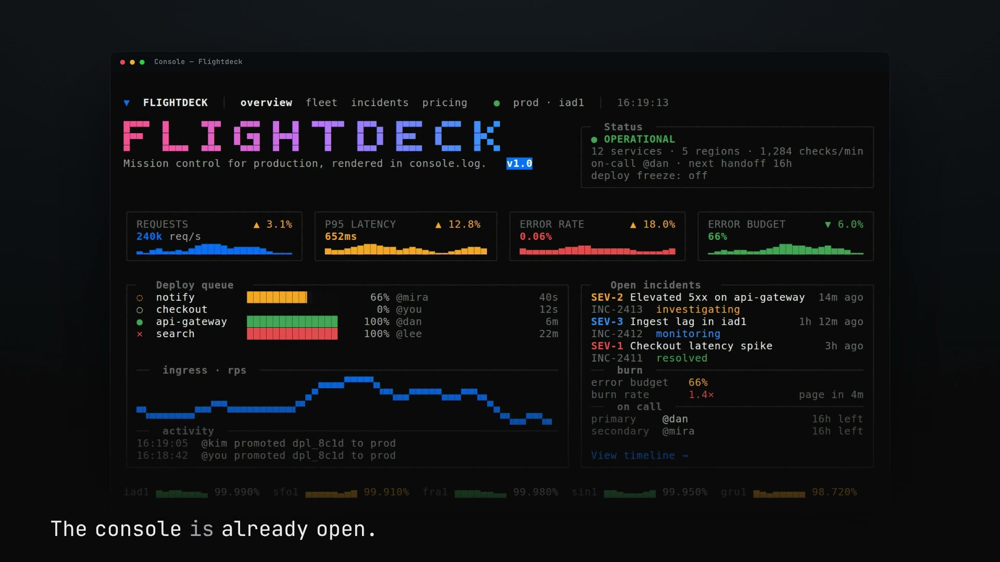
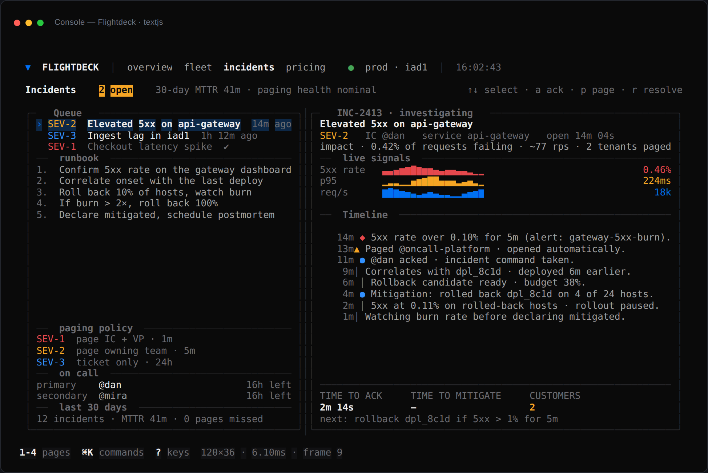
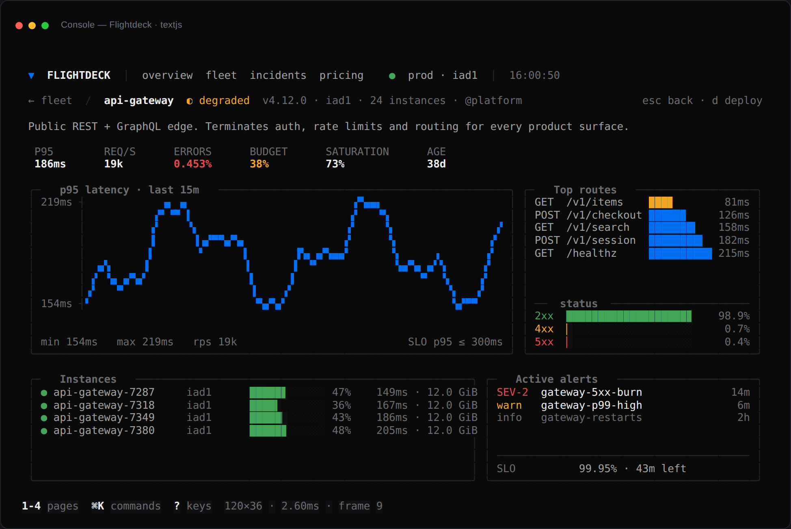
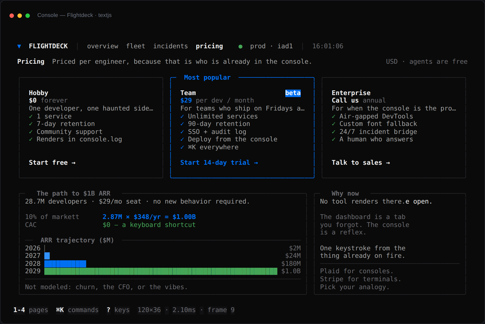
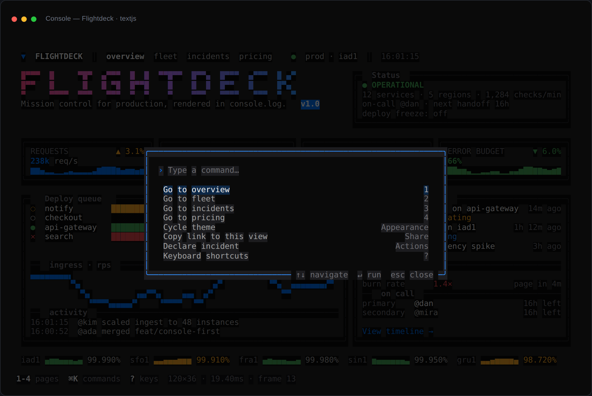

# ▼ Flightdeck

**Mission control for production, rendered inside `console.log`.**

[](LICENSE)
[](https://textjs.org)
[](#the-honest-part)

[](docs/flightdeck-launch-720p.mp4)

*Thirty-three seconds, shot entirely from the app's own console output.
[720p cut](docs/flightdeck-launch-720p.mp4) · [1080p master](https://github.com/DECRUX9812/flightdeck/releases/latest)
· [the film's source](film/)*

A console-native ops cockpit built with [Text.js](https://textjs.org): fleet health, p95 latency,
error-budget burn, deploys, incident timelines and on-call rotation — drawn as `%c` spans in the
DevTools console. Keyboard-first, `⌘K` everywhere, no dashboards, no tabs, no four-second page loads.

```bash
npm install
npm run dev      # → http://localhost:3000
```

Demo mode: add `?tick=90` to the URL for a fast heartbeat (used to record the launch film).

Then open the console (`⌘⌥J` / `Ctrl+Shift+J`) and click the page. Turn **Preserve log** off so the
console doesn't accumulate old frames — Text.js appends one `console.log` per changed frame.

## Screens

| Fleet | Incidents |
| --- | --- |
|  |  |

| Service detail | Pricing |
| --- | --- |
|  |  |



## The film

The launch video is in this repo as a re-renderable HyperFrames project: the four pieces of footage
were captured from the app's own `console.log` output at `?tick=90`, then cut on a 140 BPM grid.
Six scenes, a spec with real numbers, and an honest review of what still doesn't work:
[`film/`](film/) · [`film/SPEC.md`](film/SPEC.md) · [`film/REVIEW.md`](film/REVIEW.md).

## Routes

| Route | What it does |
| --- | --- |
| `/` | Wordmark, four live KPI cards, deploy queue, ingress chart, open incidents, on-call, region availability |
| `/fleet` | Sortable 12-service table with live p95 / rps / error rate / budget, plus p95 bars and recent deploys |
| `/fleet/[id]` | One service: p95 line chart, top routes, status-code split, instances, active alerts |
| `/incidents` | Split view: incident queue + runbook + paging policy on the left, live signals and timeline on the right |
| `/pricing` | Three plans and the path to $1B ARR. It is a joke. Mostly. |

## Keys

| Key | Action |
| --- | --- |
| `1` `2` `3` `4` | Overview / Fleet / Incidents / Pricing |
| `↑` `↓` | Move the cursor (tables, lists) |
| `⏎` | Open the selected service |
| `s` / `S` | Sort / flip sort direction in the fleet table |
| `a` `p` `r` | Ack, page, resolve (incidents) |
| `d` | Queue a deploy (service detail) |
| `esc` | Back to the fleet |
| `⌘K` / `Ctrl+K` | Command palette |
| `?` | Keyboard help |
| `shift+t` | Cycle theme |

## How it works

- **One heartbeat.** `LiveProvider` ticks once per second; every page derives its numbers from that
  tick. No per-card timers, no drift between charts, one source of motion.
- **Deterministic telemetry.** Every value is a pure function of a hash seed and the tick
  (`lib/data.ts`), so frames are reproducible for screenshots, tests and replays. No network, no
  keys, no flaky fixtures.
- **Demo mode.** `?tick=90` speeds the heartbeat up (any value ≥ 60 ms) — used to record the
  launch film without the numbers stepping once a second.
- **Only changed frames are logged.** Turbolog diffs the cell buffer, repaints damaged rows, and
  emits a single `console.log` per changed frame — an idle console costs zero calls.
- **Real app shell.** Nested layout, five routes, a dynamic segment with `notFound()`, `error.tsx`,
  `not-found.tsx`, `generateMetadata`, a command palette fed by `useKeymap`, toasts, and theme
  presets via `useAppTheme`.

```
app/
  layout.tsx              shell: nav, clock, status bar, palette, key help, toasts
  page.tsx                overview
  fleet/page.tsx          sortable service table
  fleet/[id]/page.tsx     service detail
  incidents/page.tsx      queue + timeline split view
  pricing/page.tsx        plans and the $1B math
  not-found.tsx, error.tsx
components/ui.tsx         Panel, MetricCard, Stat, Field
lib/data.ts               seeded fleet telemetry (pure, tested)
lib/live.tsx              the 1 Hz tick + clock
tests/data.test.ts        determinism, bounds, formatters
```

## Quality

```bash
npm run typecheck   # tsc --noEmit, strict
npm test            # 7 unit tests on the telemetry layer
npm run build       # production console build
```

The build prerenders the first frame of each static route into the HTML, so the console paints
before the JS bundle finishes parsing.

## Deploy

```bash
npx text build --adapter vercel       # .vercel/output
npx text build --adapter cloudflare   # dist/_worker.js
npx text build --adapter static       # static console + fmt player
```

## The honest part

This is a demo, not a company. The dashboard is a faithful mock: nothing is wired to a real metrics
store, and "prod · iad1" is a string. To make it real, replace `lib/data.ts` with a thin client over
Prometheus / Datadog / your own `/api/health`, keep the components, and the rest is unchanged.

What *is* real: the rendering, the routing, the keyboard model, the charts, and the fact that this
entire UI is 149 `%c` spans per frame in a console that was never designed to be an app surface.

## The $1B thesis

28.7M developers × $29/seat/month ≈ $10B ARR at 100% share. At 10% share: $1B. CAC: $0 — the
distribution channel is a keyboard shortcut. Everything else (churn, the CFO, whether anyone
screenshots a console for the board deck) is not modeled.

Built on [Text.js](https://textjs.org) by [Anomaly](https://anoma.ly).
