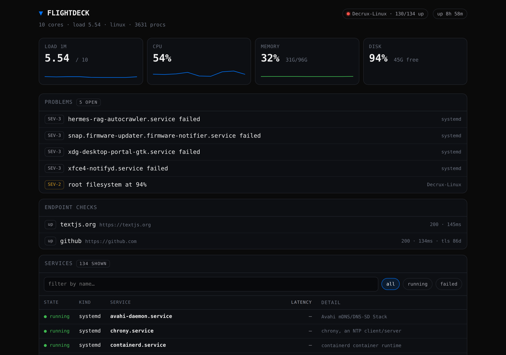
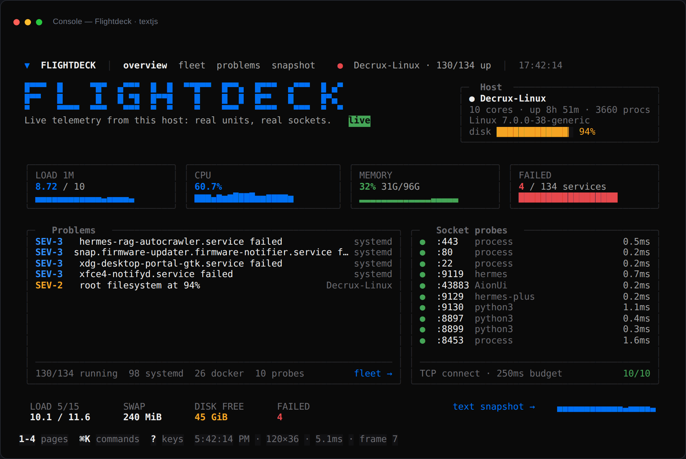
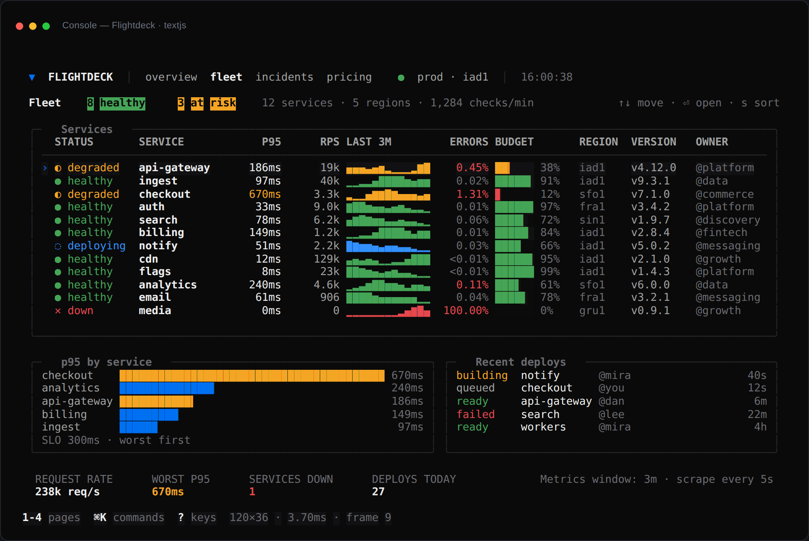
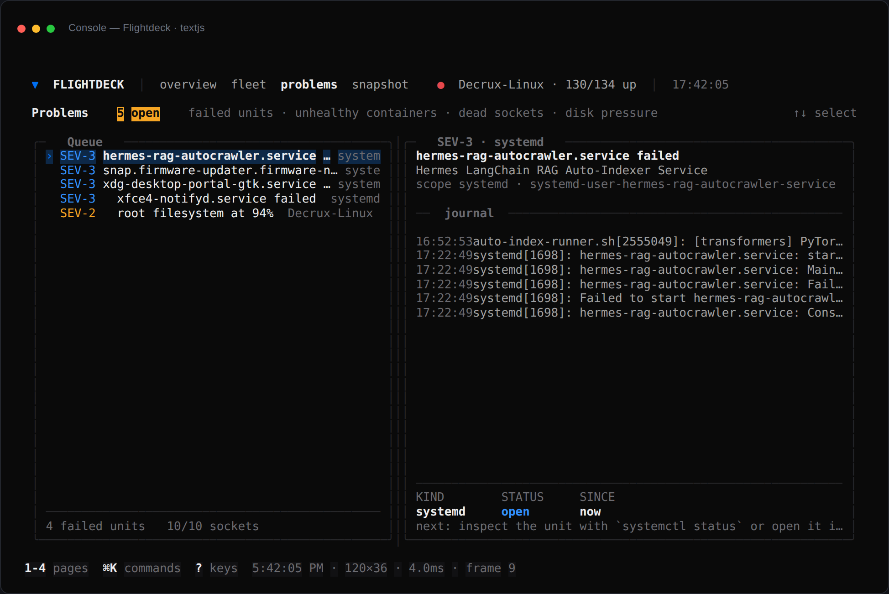
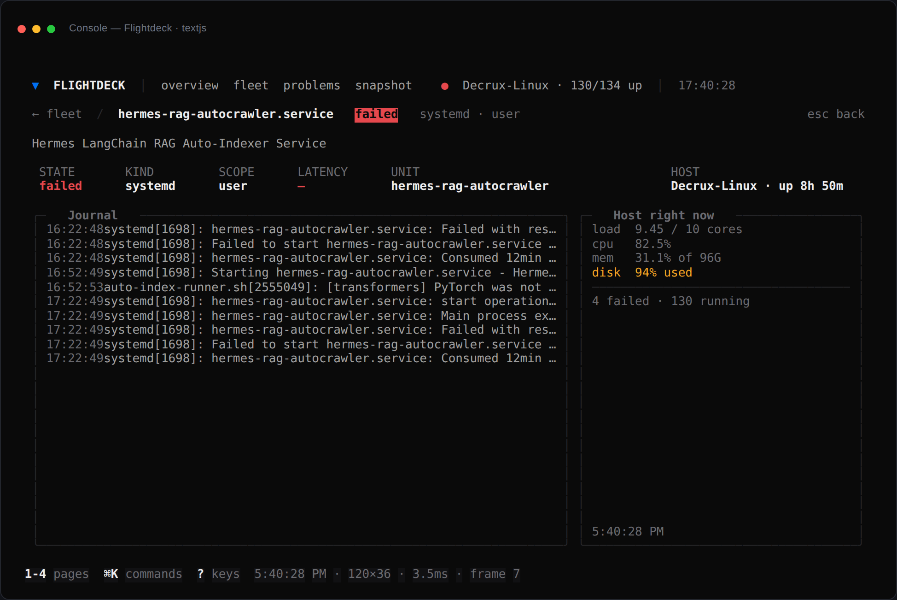
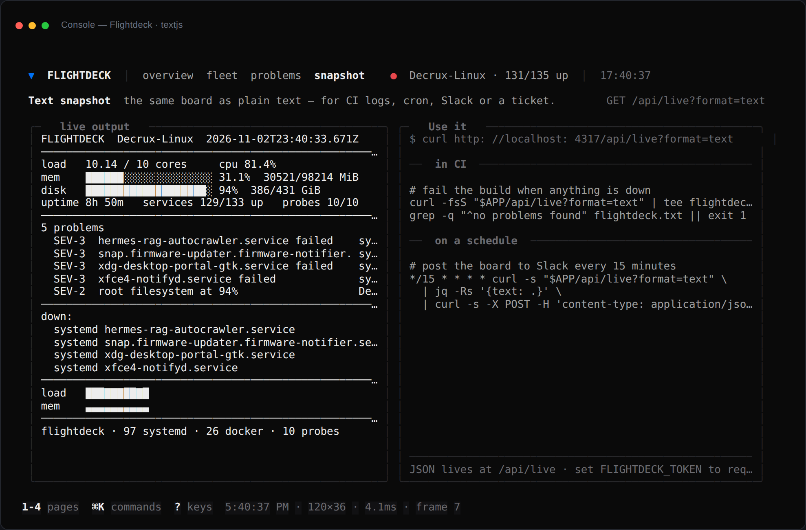

# ▼ Flightdeck

**Live telemetry for the machine you're on, rendered inside `console.log`.**

[](LICENSE)
[](https://textjs.org)
[](tests/host.test.ts)



A real status page for the machine it runs on — systemd units, Docker containers, listening sockets
probed over real TCP, `df`, `/proc` and `journalctl` — with **two surfaces**:

| Surface | Who it is for |
| --- | --- |
| **`/app`** | anyone, any device: phone, tablet, laptop. Plain HTML, no build, no framework. |
| **`/`** | the console view: the same data rendered inside DevTools as `%c` spans. |
| **`/api/live?format=text`** | CI, cron and Slack: the board as plain text. |



```bash
npm install
npm run dev                     # → http://localhost:3000        (console view)
                                # → http://localhost:3000/app    (web UI, any device)

npm run dev -- -H 0.0.0.0       # reachable from your phone on the same network
```

Then open `/app` on any device, or `/` and open the console (`⌘⌥J` / `Ctrl+Shift+J`). Turn
**Preserve log** off in the console.

### What runs where

| | Linux | macOS / Windows |
| --- | --- | --- |
| Web UI, console UI, text board, JSON API | ✅ | ✅ |
| Endpoint checks (`flightdeck.config.json`) | ✅ | ✅ |
| Docker containers (if the CLI is installed) | ✅ | ✅ |
| systemd units, `/proc` stats, `journalctl` | ✅ | — (shows an empty state, never fake numbers) |

The **UI is universal**; the **agent is Linux-first**. On another OS you still get endpoint checks
and Docker, and a clear "no sources here" message instead of a lie.

## What is actually measured

| Source | What it gives you |
| --- | --- |
| `systemctl` (system + user) | every service, its real `active`/`failed`/`auto-restart` state |
| `docker ps -a` | containers, healthy/unhealthy/exited, uptime |
| `ss -ltnp` + TCP connect | listening sockets and their **measured** handshake time (sequential, 250 ms budget) |
| `/proc/stat`, `/proc/meminfo`, `/proc/loadavg`, `/proc/uptime` | cpu %, memory, load, uptime |
| `df -P /` | root filesystem pressure |
| `journalctl` / `docker logs` | the last lines of a unit, on its detail page |

Problems are derived, not invented: failed units, unhealthy containers, sockets that listen but
don't answer, disk ≥ 90 %, memory ≥ 90 %, load above 1.5× cores.

## Screens

| Fleet | Problems |
| --- | --- |
|  |  |

| Unit detail (real journal) | Text snapshot |
| --- | --- |
|  |  |

## Endpoint checks

Add anything you want probed to `flightdeck.config.json`:

```json
{ "checks": [
  { "name": "api", "url": "https://api.example.com/health", "expect": 200 },
  { "name": "site", "url": "https://example.com", "timeoutMs": 4000 }
] }
```

Status, latency and TLS days-left are measured over real sockets, on any platform.

## Routes

| Route | What it does |
| --- | --- |
| `/` | Host panel, four live metrics, every open problem, socket probes |
| `/fleet` | Every unit/container/socket, sortable; `f` filters to what is not running |
| `/fleet/[id]` | One unit: state, scope, measured latency, real journal tail |
| `/problems` | The queue, with the journal for the selected problem |
| `/snapshot` | The plain-text board, plus the `curl`/CI/cron snippets |

## The text board (the useful bit)

```bash
curl -s localhost:3000/api/live?format=text
```

```
FLIGHTDECK  Decrux-Linux  2026-11-02T23:39:06Z
──────────────────────────────────────────────────────────────
load   10.33 / 10 cores     cpu 67.3%
mem    ██████░░░░░░░░░░░░░░ 30.2%  29685/98214 MiB
disk   ███████████████████░ 94%  386/431 GiB
uptime 8h 48m   services 131/136 up   probes 10/10
──────────────────────────────────────────────────────────────
6 problems
  SEV-3  hermes-rag-autocrawler.service failed    systemd
  SEV-2  root filesystem at 94%                   Decrux-Linux
```

JSON lives at `/api/live`. Set `FLIGHTDECK_TOKEN` to require `?token=…`.

## Keys

`1-4` pages · `↑↓` move · `⏎` open · `s` sort · `f` filter · `⌘K` commands · `?` help · `shift+t` theme.

## Quality

```bash
npm run typecheck   # tsc --noEmit, strict
npm test            # 7 tests: parsers, a real TCP probe, and collect() against this machine
npm run build       # production console build
```

The tests are not fixtures-only: `probeTcp` is checked against a real listening socket and a closed
port, and `collect()` is asserted against the running host (services exist, counts agree, disk is a
percentage).

## The honest part

- **Linux with systemd, Docker, `ss` and `journalctl`.** It shells out to them; elsewhere it reports
  nothing rather than guessing.
- **History is 60 samples held in the server process** (about two minutes at 2 s). No retention.
- **Do not expose it.** Anyone who can reach the port can read your unit names, ports and journal
  lines. Bind localhost, or set `FLIGHTDECK_TOKEN`.
- The **`docs/flightdeck-launch-720p.mp4`** launch film was shot against v0.1.0's mock-data build.
  The UI is the same; the numbers in it are not real. The real screenshots above replace it as the
  source of truth.

## The film

A 33-second launch film, re-renderable from its own HyperFrames source in [`film/`](film/), with the
[1080p master](https://github.com/DECRUX9812/flightdeck/releases/latest) as a release asset.

Built with [Text.js](https://textjs.org).
